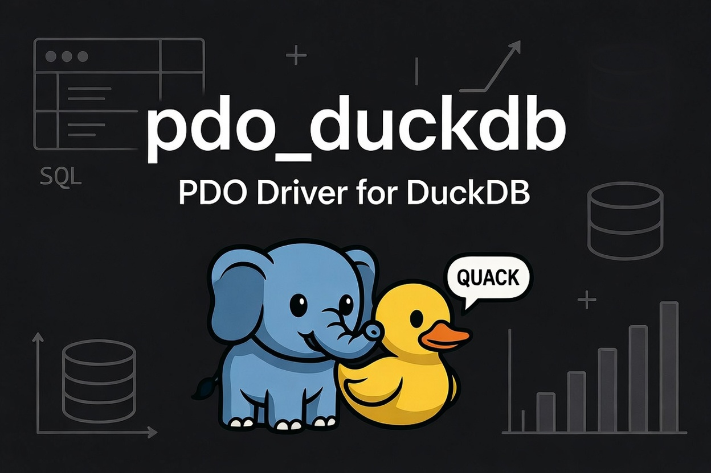

# pdo_duckdb

[](https://github.com/iliaal/pdo_duckdb/actions/workflows/tests.yml)
[](https://github.com/iliaal/pdo_duckdb/releases)
[](LICENSE)
[](https://x.com/intent/follow?screen_name=iliaa)



A [PDO](https://www.php.net/pdo) driver for [DuckDB](https://duckdb.org/), the
in-process analytical (OLAP) database. Connect to DuckDB through the standard
PDO API you already use for SQLite, MySQL, and PostgreSQL.

```php
$db = new PDO('duckdb:/path/to/analytics.duckdb');
$db->setAttribute(PDO::ATTR_ERRMODE, PDO::ERRMODE_EXCEPTION);

$stmt = $db->prepare('SELECT region, SUM(amount) AS total FROM sales WHERE year = ? GROUP BY region');
$stmt->execute([2026]);
foreach ($stmt as $row) {
    printf("%s: %s\n", $row['region'], $row['total']);
}
```

## Requirements

- PHP 8.1 or newer with the `pdo` extension
- For a source build only: DuckDB 1.5.3 or newer (`libduckdb`, complete C
  headers, and matching verified bridge sources; see [BUILDING.md](BUILDING.md)),
  available as a prebuilt bundle from the [DuckDB installation page](https://duckdb.org/docs/installation/)
  or via your package manager. Prebuilt installs (below) need nothing else.
  Prebuilt binaries bundle DuckDB 2.0.0; see [DuckDB 2.0](#duckdb-20) for
  compatibility changes when you upgrade from 1.5.

## 🚀 Installation

### PIE

```sh
pie install iliaal/pdo_duckdb
```

On Linux (x86_64/arm64), macOS (Apple Silicon), and Windows x64, PIE downloads a
self-contained prebuilt binary. No DuckDB install or build toolchain needed. On
Linux the prebuilt baseline is glibc 2.36 (Debian 12); Apple Silicon binaries
target macOS 11.0. On other platforms, older operating systems, or older PHP,
PIE falls back to a source build, which needs the complete DuckDB C header set,
`libduckdb`, and the verified C++ bridge sources matching that library. See
[building and binary targets](BUILDING.md) to obtain the matching sources.

```sh
pie install iliaal/pdo_duckdb --with-pdo-duckdb=/opt/duckdb \
  --with-pdo-duckdb-bridge-source=/opt/duckdb-source
```

### From source

```sh
phpize
./configure --with-pdo-duckdb=/opt/duckdb \
  --with-pdo-duckdb-bridge-source=/opt/duckdb-source
make
make install
```

Then enable it in `php.ini` (after `pdo`):

```ini
extension=pdo_duckdb
```

To build against DuckDB 2.0, see [DuckDB 2.0](#duckdb-20).

### Other DuckDB PDO drivers

[thomas-0816/pdo-duckdb-php](https://github.com/thomas-0816/pdo-duckdb-php) is
a separate driver that uses the same extension name (`pdo_duckdb`) and PDO
driver name (`duckdb`). Install only one of them. Both drivers define
`PDO::DUCKDB_ATTR_CONFIG` and `PDO::DUCKDB_ATTR_UNBUFFERED`, with the values
swapped: this driver uses 1000 and 1001, and the other driver uses 1001 and
1000. If you switch drivers, refer to these attributes by constant name, never
by integer value.

## DSN

```
duckdb:/path/to/database.duckdb   # file-backed database
duckdb::memory:                   # in-memory database
duckdb:                           # in-memory database (empty path)
```
Only the exact path `:memory:` (or an empty path) opens an in-memory database.
Anything else is a file path, including `:memory:foo`, which creates a file
named `:memory:foo`. For a named in-memory database, attach one in SQL:
`ATTACH ':memory:' AS name`.

### Multiple connections to one file

PDO connections to the same file share a DuckDB database instance within the
process. Committed writes are visible to the other connections and survive
closing and reopening them. Transactions and rollback remain connection-local.
Relative paths, symlinks, and hard links cannot create independent competing
instances. Each unnamed in-memory connection remains isolated.

Use compatible database configuration for every connection to a shared file;
conflicting configurations fail instead of silently opening another instance.
When a handle requires `open_basedir` containment, the shared database is
restricted for its remaining lifetime, including sibling handles. A per-handle
flag cannot restore unrestricted engine settings.

Do not unlink, rename, or replace a database while a connection or attachment
still owns it. Detected identity changes are refused until the observing
owners close; racing external replacements are outside the supported contract.
DuckDB's case-folding cache can also refuse distinct case-sensitive filenames
on Windows or macOS. Supporting those names requires a filesystem-aware engine
cache and path manager; the driver does not create competing instances to
work around that restriction.

### Connection options

Append DuckDB configuration as `;key=value` pairs on the DSN, or pass them as a
`PDO::DUCKDB_ATTR_CONFIG` array:

```php
// open a database read-only, with a memory cap
$db = new PDO('duckdb:/data/analytics.duckdb;access_mode=read_only;memory_limit=2GB');

// equivalent, via the options array
$db = new PDO('duckdb::memory:', null, null, [
    PDO::DUCKDB_ATTR_CONFIG => ['threads' => 4, 'memory_limit' => '2GB'],
]);
```

Any DuckDB setting name works (`access_mode`, `memory_limit`, `threads`, ...);
an unknown option fails the connection. `force_mbedtls_unsafe` is rejected at
connect time because libduckdb 1.5.3-1.5.6 crashes on a falsy value before the
database exists; if you need it, `SET` it after open.
`PDO::DUCKDB_ATTR_CONFIG` is connect-time only and is refused with persistent
handles, because PDO's persistent key doesn't include driver option arrays.

Persistent connections reuse the same DuckDB connection for a matching DSN.
DuckDB session and catalog state (temporary tables, `SET` options,
attachments, `:memory:` contents) can survive across requests in the same PHP
process, so don't use persistence as a tenant or request isolation boundary. On
reuse the driver resets `http_proxy` (and proxy username/password) and turns
profiling off, so those don't carry into the next request.

When `open_basedir` is set, external file access stays disabled whatever you
pass. The driver also rejects path/security-sensitive DuckDB settings such as
`allowed_directories`, `allowed_paths`, `allowed_configs`, `temp_directory`,
`extension_directory`, and extension auto-install/load knobs, and locks DuckDB
configuration after applying the sandbox profile. DuckDB has no
descriptor-based open API, so the database-file path check and DuckDB's open
are separate filesystem operations. For file-backed databases, keep every
writable path component below trusted, non-writable directory ancestry so an
attacker can't swap in a file or symlink between the check and the open.

## 🛠️ Bulk insert (Appender)

For fast bulk loads, `PDO::duckdbAppender()` returns a `Pdo\Duckdb\Appender`
wrapping DuckDB's native appender, far faster than row-by-row `INSERT`:

```php
$db->exec('CREATE TABLE events (id INTEGER, name VARCHAR, ts TIMESTAMP)');

$app = $db->duckdbAppender('events');      // optional 2nd arg: schema name
foreach ($rows as $r) {
    $app->appendRow($r['id'], $r['name'], $r['ts']);
}
$app->flush();   // push buffered rows; appender stays open for more rows
$app->close();   // flush + finalize; further append/flush/close throw
```

`flush()` commits buffered rows and leaves the appender usable. `close()`
flushes, finalizes the native appender, and marks the PHP object closed.
Prefer an explicit `close()`. If you don't close an appender, PHP closes it when
the appender or its connection is destroyed:

- The buffered rows are flushed when you unset the appender, during garbage
  collection, and at the end of the request, including after a fatal error. A
  failed flush raises a warning. In autocommit mode the rows are committed; in
  an open transaction they join it.
- If a transaction is still open when the PDO object is destroyed, PDO rolls it
  back and the appender's buffered rows are discarded with it, whichever of the
  two objects PHP frees first. On PHP versions where several PDO objects share
  one persistent handle and PDO rolls the handle back when the first of them
  is freed, an appender that belongs to another of those PDO objects keeps its
  rows and flushes them in autocommit, as after an explicit `rollBack()`.
- An explicit `rollBack()` doesn't discard the buffer. Rows you appended but
  didn't flush stay buffered and are written by the next flush, in autocommit
  or in whatever transaction is open then. Call `flush()` before you commit or
  roll back so the rows land in the transaction you intend.
- DuckDB flushes the appender on its own every 204,800 rows (DuckDB 1.5).
  Those rows join the transaction that is open at that moment, so a later
  discard of the buffer doesn't remove them.
- Rows that a failed append, flush, or close leaves in the buffer are
  discarded. They are never flushed later.

Soft validation failures (`ValueError`/`TypeError` for arity, types, ranges)
leave the appender live so you can retry the row. Scalar cast validation also
runs before any native append touches the row, using range checks or a prepared
`CAST` probe where the target type supports one. This covers invalid strings
(e.g. `'not-a-date'` into `DATE`), uncastable booleans and numbers, and numeric
overflow. It doesn't check `VARCHAR` strings for valid UTF-8 (see below).
`BLOB` columns accept only strings or `null`; other scalars throw `TypeError`.
Cast-probe failures and finite overflow in a top-level `FLOAT` column throw
`PDOException("Failed to append value: …")`, preserving the appender and its
buffered rows. Hard DuckDB failures on append/flush/close (including casts
without an available preflight probe) poison the appender:
later use throws `Error` and you must create a new one. Rows already flushed
survive, but buffered rows are lost, so call `flush()` per unit of work to
bound the loss.

The appender doesn't check strings for valid UTF-8 before a top-level
`VARCHAR` append. If you pass invalid UTF-8 for a `VARCHAR` column,
`appendRow()` accepts it, and the next `flush()` or `close()` throws
`PDOException` and poisons the appender, losing every buffered row, including
valid rows appended before and after the bad one. Invalid UTF-8 inside a `LIST`,
`ARRAY`, `STRUCT`, or `MAP` value throws `TypeError` (`argument #N contains a
string that is not valid UTF-8`) and leaves the appender live. Invalid UTF-8
for a `UNION` member throws `PDOException` from `appendRow()` and poisons the
appender. If your input can contain arbitrary bytes, validate it first, for
example with `mb_check_encoding($s, 'UTF-8')`, or store it in a `BLOB` column.

`appendRow(...$values)` takes one argument per column (left to right) and
returns the appender for chaining. PHP `null`/`bool`/`int`/`float`/`string` map
to DuckDB values; DuckDB casts them to the target column types. For nested
columns, pass a PHP array: a list fills `LIST`/`ARRAY`, and an associative array
fills `STRUCT` (by field name) or `MAP`. Nesting deeper than 128 levels is
rejected.

For a DuckDB 2.0 tuple, pass a positional array with one value per field. For
VARIANT input, sequential arrays become arrays, associative arrays and plain
`stdClass` objects become objects, and strings remain strings. Use `(object) []`
for an empty object. Native-fetch `type`/`value` wrappers are output formats;
passing one to the Appender creates an ordinary object with those fields.

```php
$db->exec('CREATE TABLE t (tags VARCHAR[], attrs STRUCT(x INTEGER, y VARCHAR))');
$app = $db->duckdbAppender('t');
$app->appendRow(['php', 'duckdb'], ['x' => 1, 'y' => 'hi']);
$app->flush();
```

Pass a column list as the third argument to append only some columns; the rest
take their `DEFAULT` (or `NULL`). This helps with tables that generate keys or
timestamps:

```php
$db->exec("CREATE SEQUENCE seq");
$db->exec("CREATE TABLE events (id BIGINT DEFAULT nextval('seq'), ts TIMESTAMP DEFAULT now(), payload VARCHAR)");
$app = $db->duckdbAppender('events', null, ['payload']);
$app->appendRow('hello')->appendRow('world');   // id and ts fill themselves
$app->flush();
```

The schema argument accepts a literal string or a list of identifier segments.
A string such as `'sales.eu'` names one schema containing a dot; it is never
parsed as SQL. On DuckDB 2.0, use `['sales', 'eu']` to select nested schema
`sales.eu` in the current catalog. Table, schema, and column names are quoted
as identifiers, including embedded quotes and dots. Column subsets work with
both forms. DuckDB 1.5 accepts a one-segment list and rejects nested paths.

On PHP 8.4+, `PDO::connect('duckdb:…')` returns a `Pdo\Duckdb` instance and
`duckdbAppender()` lives on that subclass. On `new PDO('duckdb:…')` (and on PHP
8.1-8.3) the method is available on the PDO object directly. PHP 8.5 emits a
deprecation for driver methods called on the base `PDO` class, so on 8.4+
prefer `PDO::connect()`.

## 🔍 Query helpers

Two driver-specific methods, available on the same object as `duckdbAppender()`:

```php
// Tables a query references, resolved by DuckDB's parser (UPDATE, DELETE, and
// MERGE return []). Pass true to include a non-default schema.
$db->duckdbTableNames('SELECT * FROM users u JOIN s.orders o ON u.id = o.id');
// ['orders', 'users']
$db->duckdbTableNames('SELECT * FROM s.orders', true);   // ['s.orders']

// Profiling tree of the last executed query. Enable profiling first; the method
// reads the recorded profile and runs nothing itself. Returns null until then.
$db->exec("PRAGMA enable_profiling='no_output'");
$db->query('SELECT count(*) FROM events WHERE ts > now() - INTERVAL 1 DAY');
$profile = $db->duckdbLastProfile();
// ['metrics' => ['QUERY_NAME' => '…', 'LATENCY' => '0.004', …],
//  'children' => [ ['metrics' => ['OPERATOR_NAME' => 'SEQ_SCAN', …], 'children' => […]] ]]
```

Profiling metric values are strings, or PHP `null` when DuckDB reports a SQL NULL
for that metric; cast the numeric strings as needed. DuckDB defines the metric
names and the tree layout, and DuckDB 2.0 reshapes both (see
[DuckDB 2.0](#duckdb-20)).

## 🧩 DuckDB extensions

DuckDB extensions load through ordinary SQL, no special API:

```php
$db->exec('LOAD json');                     // bundled extensions load offline
$db->exec('INSTALL httpfs; LOAD httpfs;');  // downloadable extensions
```

## Usage notes

### Placeholders

You can use positional `?` or named `:name` placeholders; a repeated `:name`
is bound once. The scanner leaves placeholders inside SQL comments, quoted
strings, quoted identifiers, and dollar-quoted strings untouched. You can
also bind the path in `ATTACH ? AS name`: preparing it neither creates nor
attaches the database; `execute()` performs the attachment.

Because `:` is reserved for placeholders, inline `STRUCT`/`MAP` literals in
prepared queries must keep a space after the colon (`{'k': 1}`, not `{'k':1}`).

### Parameter binding

The driver re-reads each bound value on every `execute()`. A value bound by
reference with `bindParam()` is converted from the variable's current contents
each time, so assigning to the variable between executes takes effect without
re-binding. A `PDO::PARAM_LOB` stream is read to the end and then rewound, so
re-executing the same statement binds the same bytes rather than an empty
value. Streams larger than 64MB are rejected instead of buffered whole.
Non-seekable streams can't be rewound, so re-executing binds the remainder.

Don't call `execute()` on a statement from inside a `__toString()` that the
same statement is binding: PDO core caches its bound-parameter table across the
conversion and crashes. The bug is in PDO itself and affects every driver.

### Cursors

Cursors are forward-only. DuckDB returns results one chunk at a time in a
single direction, so `PDO::ATTR_CURSOR => PDO::CURSOR_SCROLL` is rejected at
`prepare()` rather than failing on the first backwards fetch. If you need
random access, use `fetchAll()` and index the array.

### Transactions

`beginTransaction()` / `commit()` / `rollBack()` map to DuckDB
`BEGIN TRANSACTION` / `COMMIT` / `ROLLBACK`. DuckDB is autocommit-by-default
with no session toggle, so `setAttribute(PDO::ATTR_AUTOCOMMIT, false)` is
rejected; use `beginTransaction()` for explicit transactions.

The driver also reflects raw transaction-control SQL through `inTransaction()`,
so a persistent handle can't keep an invisible transaction after PHP releases
the PDO object. This covers DuckDB's `END` and `ABORT` aliases and transaction
control wrapped by `EXPLAIN ANALYZE`. DuckDB reports only the outer `EXPLAIN`
statement type, so the driver tracks the wrapped effect itself after the
statement succeeds.

### Multi-statement `exec()`

`exec()` returns the last statement's row count:
`exec("BEGIN; INSERT ...; COMMIT")` reports `COMMIT`'s count (`0`), not the
INSERT's. If you need the intermediate `rowCount()`, split the statements.

### `open_basedir`

When `open_basedir` is set, DuckDB's SQL-level external file access
(`read_csv`, `COPY`, `ATTACH`, `httpfs`, …) is disabled, so the sandbox covers
SQL as well as the database file path. If `open_basedir` is tightened after a
handle exists, the driver clears DuckDB path allowlists before disabling
external access and locks the connection configuration. You can still load an
extension compiled into DuckDB, such as `LOAD json`; the sandbox blocks
extension files and downloads.

Tightening `open_basedir` on an open handle also switches DuckDB logging to
in-memory storage (`logging_storage='memory'`), on every DuckDB version. If the
connection was logging to a file (`CALL enable_logging(storage='file', ...)`),
that file gets no new lines from then on, and neither the driver nor DuckDB
reports the switch. `CALL enable_logging()` doesn't restore the file sink;
DuckDB 2.0 rejects the call because the configuration is locked. Read
later entries from `duckdb_logs`, or open the connection with the final
`open_basedir` already in place if you need a file log outside the sandbox.

Disabling external access doesn't stop an extension that opens files, sockets,
or listeners itself. So when the driver sandboxes a connection after it opens
(you tighten `open_basedir` mid-request, or a persistent connection is reused),
it first checks the loaded extensions. If any extension outside `autocomplete`,
`core_functions`, `excel`, `fts`, `httpfs`, `icu`, `inet`, `json`, `parquet`,
`spatial`, `tpcds`, `tpch`, and `vss` is loaded (for example `quack`,
`sqlite_scanner`, or `postgres_scanner`), every later SQL call on that
connection fails with driver code 4, and the message names the extensions. The
driver also stops the connection's `quack` listeners. A reused persistent
connection is replaced by a new connection that's sandboxed when it opens. On
PHP releases before 8.4.26 and 8.5.11 (including every 8.1–8.3 release), PDO
core leaks the discarded persistent handle's bookkeeping (191 to 223 bytes in
local leak-checked runs) on each replacement; the driver doesn't control that
path. If you need one of those extensions, load it only on connections that
never run under a tightened `open_basedir`.

The same check also runs when a connection opens under `open_basedir`. It lists
extensions with DuckDB's `duckdb_extensions()`, which reads the `.info` file of
every extension in the extension directory. If that listing fails, the
connection is refused the same way, and an already running connection also has
its `quack` listeners stopped. One failure is transient: while another process
runs `INSTALL` into the same extension directory, the listing can collide with
that install's temporary `.info` file. The driver retries that error every
millisecond for up to 500 ms. If the collisions outlast that, the connection
is still refused; any other listing error (for example, a corrupt `.info`
file) refuses it without waiting.

Locking the configuration blocks *every* later `SET`, including settings with
no security impact (`threads`, `memory_limit`, `preserve_insertion_order`,
`default_null_order`, …). Pass those at connect time instead, in the DSN tail
or `PDO::DUCKDB_ATTR_CONFIG`, where the sandbox allows anything that isn't
path- or extension-related. `TimeZone` is the exception: it's a SQL-only
setting with no `duckdb_set_config` equivalent, so under `open_basedir` it
stays at DuckDB's default for the life of the handle.

### `lastInsertId()`

`lastInsertId()` isn't supported because DuckDB has no implicit rowid. For
generated keys, use a sequence and `currval()`.

### Type mapping

| DuckDB type | PHP value | DuckDB 2.0+ build |
|-------------|-----------|-------------------|
| `BOOLEAN` | `int` `0`/`1` (not `bool`) | Same |
| `TINYINT`, `SMALLINT`, `INTEGER`, `BIGINT`, `UTINYINT`, `USMALLINT`, `UINTEGER` | `int` (a string for `BIGINT`/`UINTEGER` values outside the PHP integer range on 32-bit PHP) | Same |
| `FLOAT`, `DOUBLE` | `float` | Same |
| `BLOB` | binary string | Same |
| everything else (`VARCHAR`, `DATE`/`TIME`/`TIMESTAMP`, `DECIMAL`, `HUGEINT`/`UBIGINT`/`UHUGEINT`, nested types, `VARIANT`) | canonical string form (see `GEOMETRY` and `TIMESTAMPTZ` below) | Same, including the zero-field `STRUCT` (`{}`) that only DuckDB 2.0 can build |
| `TIMESTAMPTZ_NS` | Unavailable in DuckDB 1.5 | canonical string form of the UTC instant, like `TIMESTAMPTZ` |
| A type newer than the DuckDB headers the driver was built with | unsupported; legacy fallback is `null` | `null` when NULL; any other value reports a PDO error |
| SQL NULL | `null` | Same |

Build the driver against the exact DuckDB sources and headers matching the
library it loads. The extension checks this identity during configuration and
module startup and refuses a mismatched library. This requirement applies to
both DuckDB 1.5.3+ and 2.0 builds.

`getColumnMeta()` reports the real DuckDB type name per column and a `pdo_type`
that matches the default fetch mapping: `PDO::PARAM_INT` for exactly `BOOLEAN`,
`TINYINT`, `SMALLINT`, `INTEGER`, `BIGINT`, `UTINYINT`, `USMALLINT`,
`UINTEGER`; `PDO::PARAM_LOB` for `BLOB`; `PDO::PARAM_STR` for everything else
(so `UBIGINT` and `HUGEINT` stay `PARAM_STR`). `DECIMAL` columns also report
`precision`/`scale`. On a DuckDB 2.0 build, `TIMESTAMPTZ_NS` columns report
`TIMESTAMP_TZ_NS`, and a column of DuckDB's `NULL` type reports `NULL` with
`PDO::PARAM_NULL`. DuckDB 2.0 gives a bare `SELECT NULL` that type; DuckDB 1.5
types it `INTEGER`.

Use `getColumnMeta($column)['duckdb:decl_type']` for the complete logical
declaration, including decimal parameters, nested fields, array dimensions,
and aliases retained by DuckDB, such as `JSON`. Unnamed structs report
`STRUCT(INTEGER, VARCHAR)` on 1.5 and `TUPLE(INTEGER, VARCHAR)` on 2.0.
You can read this additive field after execution, even for empty results;
re-execution refreshes it when bindings change the result type. Existing
`native_type`, `pdo_type`, `precision`, and `scale` fields remain unchanged.

Read `getColumnMeta($column)['duckdb:type_annotations']` for collations retained
by the engine. This list is empty for types without retained collations. Each
entry contains `collation` and a `path` of zero-based logical child positions:
`[]` identifies the column itself; LIST/ARRAY elements use `0`, STRUCT/TUPLE
fields and UNION members use their declaration order, and MAP keys and values
use `0` and `1`. For example, `['Ab' COLLATE nocase]` reports
`[['path' => [0], 'collation' => 'nocase']]`. Ordinal paths remain unambiguous
when field names contain dots or NUL bytes. Collations stay separate from
`duckdb:decl_type` because nested SQL type declarations cannot contain `COLLATE`.

Nested values with boolean, integer, `FLOAT`/`DOUBLE`, `DECIMAL`, `DATE`,
`TIME`, `TIMESTAMP`, `UUID`, and `VARCHAR` leaves use a direct renderer that
applies DuckDB's quoting rules, so
`[TIMESTAMP '2020-01-01 10:00:00']` returns `['2020-01-01 10:00:00']`, exactly
like `CAST(... AS VARCHAR)`. DuckDB 2.0 also applies those quoting rules to
`ARRAY` elements and quotes strings containing backslashes; DuckDB 1.5 retains
its older formatting. Other nested values use DuckDB's own renderer.
Nested fetches return canonical strings by default. Enable native structured
fetches below, or use SQL projections such as `unnest` and `struct_extract`,
when you need individual values.

Rendering preserves embedded NUL bytes in ENUM labels, nested names, and values. For example,
`['a' || chr(0) || 'b']` returns the five-byte PHP string `"[a\0b]"`.
This fixes the earlier truncation at the first NUL; top-level `VARCHAR` and
`BLOB` remain binary-safe.
Result column names also retain their full length in metadata, associative
fetches, and named column bindings.

`GEOMETRY` returns its WKB bytes as an uppercase hex string. Nested `GEOMETRY` elements inside `LIST`/`ARRAY`/`STRUCT`/`MAP`/
`UNION` render the same uppercase hex per element, because the C API has no
geometry value constructor and the driver declares those containers with
`VARCHAR` in place of `GEOMETRY`. For WKT, select `CAST(col AS VARCHAR)`, or
call `ST_AsText()` from the spatial extension.

`TIMESTAMPTZ` native fetches render the instant in UTC (`+00`), both at the top
level and as a nested leaf. For DuckDB's session-`TimeZone` rendering, select
`CAST(col AS VARCHAR)`. `TIMESTAMPTZ_NS` on DuckDB 2.0 follows the same rule.

`VARIANT` values are supported at the top level and inside nested types. Default
fetches render their values as strings, preserving object keys and container
shape. Native structured fetches retain the dynamic type as well.

### Native structured fetches

Set `PDO::DUCKDB_ATTR_NATIVE_STRUCTURES` to `true` to fetch structured values
as `stdClass` objects with `type` and `value` properties. The payload contains
native PHP arrays and scalars. The default is `false`; scalar column mappings
stay unchanged.

```php
$db->setAttribute(PDO::DUCKDB_ATTR_NATIVE_STRUCTURES, true);
$stmt = $db->prepare('SELECT [1, NULL, 3], MAP([42], [1.25::DECIMAL(5,2)])');
$stmt->execute();
$row = $stmt->fetch(PDO::FETCH_NUM);
assert($row[0]->type === 'INTEGER[]');
assert($row[0]->value === [1, null, 3]);
assert($row[1]->value === [['key' => 42, 'value' => '1.25']]);
```

Statements capture the connection default when prepared. Override it with
`prepare($sql, [PDO::DUCKDB_ATTR_NATIVE_STRUCTURES => true])` or the statement's
`setAttribute()`; read it with `getAttribute()`. This works with buffered and
unbuffered execution and after re-execution. Returned values own their data
and remain usable after the cursor closes or advances to another chunk.

The wrapper's `type` is the complete logical declaration. JSON uses `JSON`;
VARIANT uses its dynamic type, including `ARRAY`, `OBJECT`, or `NULL`. SQL NULL
returns PHP `null` without a wrapper. The `value` property uses these shapes:

| SQL value | Native payload |
|-----------|----------------|
| LIST, fixed ARRAY, TUPLE/unnamed STRUCT | Zero-based array in element order |
| Named STRUCT | Array indexed by field name, using PHP's normal numeric-string key conversion |
| MAP | List of `['key' => key, 'value' => value]` entries, preserving non-string and binary keys |
| UNION | `['tag' => memberName, 'value' => value]`, including a NULL member |
| JSON | A JSON node, as described below |
| VARIANT | Its scalar value, tagged array elements, or ordered object entries |

Empty LIST, ARRAY, TUPLE, STRUCT, and MAP payloads use `[]`; their declared type
remains in the wrapper and `duckdb:decl_type`. VARIANT objects contain ordered
`['key' => name, 'value' => taggedValue]` entries, so empty and NUL-containing
names survive. VARIANT arrays contain tagged elements. Nested VARIANT values
use `['type' => logicalType, 'value' => payload]` arrays. A VARIANT null's
wrapper has `type === 'NULL'` and `value === null`, distinct from SQL NULL.

JSON nodes use arrays for JSON arrays and
`['type' => 'object', 'value' => entries]` for objects, including empty objects.
Object entries preserve order, duplicate keys, and NUL bytes. Numbers use
`['type' => 'number', 'value' => originalNumberText]`, preserving large values,
negative zero, and exponent spelling. Strings, booleans, and JSON null use
PHP strings, booleans, and `null` inside the outer JSON wrapper.
Nested JSON values retain `['type' => 'JSON', 'value' => node]` arrays. Accepted
non-finite JSON number tokens also remain exact strings in tagged number nodes.

SQL scalar leaves keep the default mappings: BOOLEAN is `0`/`1`, exact
DECIMAL and wide integers remain strings, temporal values retain their
precision, and GEOMETRY remains uppercase hex WKB. Binary strings and keys
retain their full lengths. Native conversion rejects excessive nesting beyond
its 128-level limit with a fetch error; it never returns a partial value.

PDO's fetch modes still control the surrounding row. `ATTR_STRINGIFY_FETCHES`
takes precedence and returns the default textual values. Scalar `bindColumn()`
selects the default mapping for that column in every row view, before native
conversion; PDO applies the requested scalar coercion to the bound variable.
Other columns remain native. This also lets you bind deeply nested JSON as
text without triggering native nesting limits.

`FETCH_KEY_PAIR`, `FETCH_GROUP`, and `FETCH_UNIQUE` require scalar key columns.
Cast a structured key in SQL or bind that column as `PDO::PARAM_STR`; a native
wrapper object cannot be a PHP array key.

Wrapper objects let `FETCH_NAMED` distinguish a structured payload from PDO's
array of duplicate-name columns. They have normal PHP object identity:
`FETCH_BOTH`'s named and numeric entries reference the same wrapper, and copying
a row shares its wrapper objects. Clone a wrapper if you need an independent
mutable copy. The attribute changes fetching only; it does not change parameter
binding or the Appender's input contract.

### Streaming results

By default `execute()` returns a materialized result: DuckDB buffers the full
result set before PDO fetches, so available memory bounds a large `SELECT`.
For large scans, set `PDO::DUCKDB_ATTR_UNBUFFERED` to fetch chunks lazily
through DuckDB's pending-result API:

```php
$db->setAttribute(PDO::DUCKDB_ATTR_UNBUFFERED, true);
```

An unbuffered result needs the connection to itself until you finish reading
it or call `PDOStatement::closeCursor()`. This includes a single-row result
after its first `fetchColumn()`: fetch again to reach the end, or close it.
If you need to interleave queries, use a buffered result or a second connection.

On DuckDB 2.0, preparing or running another statement while the result is
open fails with `Resource In Use Error: connection has an open result; drain
or destroy it before starting a new query`. The original result remains
readable. Drain or close it before retrying the other statement. Under
`PDO::ERRMODE_SILENT` or `PDO::ERRMODE_WARNING`, check the other statement's
return value and the connection's `errorInfo()`.

On DuckDB 1.5, the other statement succeeds and aborts the partially read
result. Rows from the current chunk (up to 2048) stay readable; the next chunk
fetch throws with driver code 5 (`Attempting to execute an unsuccessful or
closed ... result`), even when there were no further rows. Under silent or
warning mode, that fetch returns `false`. Check the original statement's
`errorCode()` immediately after the loop: an abort reports `HY000` and
`errorInfo()[1]` is 5. Another fetch resets the code to `00000`. To rerun an
aborted query, call `closeCursor()` and then `execute()`.

Persistent connections reset `DUCKDB_ATTR_UNBUFFERED` and
`DUCKDB_ATTR_NATIVE_STRUCTURES` to false on every
checkout (`check_liveness`). Pass it again in the constructor options, or call
`setAttribute` after each `new PDO(..., [PDO::ATTR_PERSISTENT => true])`.

## DuckDB 2.0

Prebuilt binaries use DuckDB 2.0.0. Source builds continue to support DuckDB
1.5.3 and newer, with version-specific behavior described below. Keeping
source compatibility does not make the engine upgrade transparent: new
database files, SQL errors, streamed results, and canonical nested strings
can behave differently.

### Build against 2.0

Download the `duckdb-shared-libs-<platform>.tar.gz` bundle from the
[DuckDB 2.0.0 release](https://github.com/duckdb/duckdb/releases/tag/v2.0.0). Put
every header from the bundle in `include/`, put the shared library in `lib/`,
and point `configure` at that prefix:

```sh
./configure --with-pdo-duckdb=/opt/duckdb-2.0 \
  --with-pdo-duckdb-bridge-source=/opt/duckdb-2.0-source
```

DuckDB 2.0 still reports C API version 1.5.6 in `duckdb.h`, so `configure`
detects 2.0 from `duckdb_v2.h` in the same directory as `duckdb.h`:

- If the complete header set is missing, `configure` stops. Install all headers
  from the matching bundle rather than copying only `duckdb.h`.
- If the headers are 2.0 but `libduckdb` is older, `configure` stops with an
  error.

A 2.0 build reports `DuckDB 2.0 headers => yes` in `phpinfo()`.

### Storage version

By default DuckDB 2.0 creates new database files that DuckDB 1.5 can't open:

```text
IO Error: Trying to read a database file with version number 69, but we can only read versions between 64 and 68.
```

Opening an existing 1.5 file with 2.0 preserves its older format, including
after updates and inserts. If DuckDB 1.5 must also read a new file, set
`storage_compatibility_version` when
you open it, in the DSN or in `PDO::DUCKDB_ATTR_CONFIG`:

```php
$db = new PDO('duckdb:/data/shared.duckdb;storage_compatibility_version=v1.5.6');

$db = new PDO('duckdb:/data/shared.duckdb', null, null, [
    PDO::DUCKDB_ATTR_CONFIG => ['storage_compatibility_version' => 'v1.5.6'],
]);
```

To write one attached database in the older format, pass `STORAGE_VERSION` to
`ATTACH`:

```php
$db->exec("ATTACH '/data/export.duckdb' AS export (STORAGE_VERSION 'v1.5.6')");
```

To check the format of an open database, read its `storage_version` tag. It
reports `v2.0.0+` for the 2.0 format. DuckDB 1.5 can open a file with an older
tag, such as `v1.5.0+`:

```sql
SELECT database_name, tags['storage_version'] FROM duckdb_databases();
```

On DuckDB 1.5, a new file's default compatibility format predates VARIANT
storage. If you need VARIANT table columns, open the file with
`storage_compatibility_version=v1.5.3` or a later supported version. An
in-memory database does not have that file-format restriction. A compatibility
tag describes the format; verify interoperability by actually reopening the
file with every engine version that must use it.

### SQL behavior changes

These changes come from DuckDB itself. Each one has a setting that restores
the 1.5 behavior, which you can pass in the DSN tail or
`PDO::DUCKDB_ATTR_CONFIG`. Under `open_basedir` the driver locks the
configuration, so set them when you connect. DuckDB 1.5 refuses the connection
for `default_transaction_invalidation_policy`, `error_on_division_by_zero`, and
`enable_legacy_parser` (`The following options were not recognized`), so pass
those only to a 2.0 build. DuckDB 1.5 accepts `lambda_syntax`.

- **Errors abort the transaction.** Inside `beginTransaction()`, any failed
  statement, including a parser or catalog error, aborts the transaction.
  Every later statement fails with `TransactionContext Error: Current
  transaction is aborted (please ROLLBACK)`. DuckDB 1.5 keeps the transaction
  open after parser and catalog errors, and aborts it on execution errors
  such as a constraint violation. In both versions,
  `commit()` on an aborted transaction returns `true` and keeps nothing, so
  call `rollBack()` after a failed statement. To keep parser and catalog errors
  from aborting, set
  `default_transaction_invalidation_policy=SYNTACTIC_ERRORS_DO_NOT_INVALIDATE`.
- **Integer division by zero throws.** `1 // 0` and `1 % 0` raise `Invalid
  Input Error: Division by zero` instead of returning `NULL`. `1 / 0` still
  returns `INF`. To return `NULL`, wrap the expression in `TRY(...)` or set
  `error_on_division_by_zero=false`.
- **Single-arrow lambdas are rejected.** `list_transform(l, x -> x + 1)` raises
  `Binder Error: Deprecated lambda arrow (->) detected`. Write
  `lambda x: x + 1`, which also works on 1.5, or set
  `lambda_syntax=ENABLE_SINGLE_ARROW`. DuckDB plans to remove that setting.
- **New default parser.** DuckDB 2.0 uses its PEG parser, so accepted syntax and
  diagnostic text can differ. `enable_legacy_parser=true` loads the downloadable
  `legacy_parser` extension if you need the old parser. You cannot load it under
  `open_basedir`; a handle that has already loaded it is refused if you later
  tighten `open_basedir`. Prepared bindings follow the selected parser, including
  per-query fallback: `$1_0` means parameter 10 with PEG and parameter 1 with the
  legacy parser. Use `?` or `:name` for portable parameter numbering.

### New SQL features

- **Triggers.** `CREATE TRIGGER` runs through `exec()`. `rowCount()` and the
  `exec()` return value count only the rows of the statement you ran, not the
  rows its triggers write. A `FOR EACH ROW` trigger body must reference `NEW` or
  `OLD`. Appender inserts also run triggers.
- **Data-modifying CTEs.** You can prepare a query such as
  `WITH inserted AS (INSERT INTO t VALUES (?) RETURNING *) SELECT * FROM inserted`.
  Its outer `SELECT` returns rows and has `rowCount()` zero.
- **Session-variable shorthand.** `SELECT $x` reads a variable set with
  `SET VARIABLE x = ...`. You can combine it with PDO's `?` or `:name`
  placeholders, including a repeated `:x` alongside `$x`. PDO bindings and
  session variables remain separate; an omitted PDO binding reports an error.
  On DuckDB 1.5, use `getvariable('x')`; `$x` has no session-variable fallback.
- **VARIANT and JSON.** `variant_*` and `json_*` functions work in plain SQL,
  for example `variant_extract(v, 'a')::INTEGER`. Both support the optional
  [native structured fetch representation](#native-structured-fetches).

### Types

A build against the DuckDB 2.0 headers handles the types that DuckDB 2.0 adds
or changes. The [type mapping](#type-mapping) table lists the PHP values.

- **`TIMESTAMPTZ_NS`.** Fetches return the UTC instant with up to nine
  fractional digits, for example `2020-01-01 00:00:00.123456789+00`, at the top
  level and inside `LIST`, `ARRAY`, `STRUCT`, `MAP`, and `UNION` values. The
  session `TimeZone` doesn't change the result. The appender casts strings into
  `TIMESTAMPTZ_NS` columns. It checks each scalar before appending, so a string
  that DuckDB can't parse, or an integer or float, throws a `PDOException` and
  leaves the appender usable. A bad value inside a nested column throws a
  `ValueError`.
- **`NULL` type.** A bare `SELECT NULL`, or a parameter bound to `null` in a
  select list, produces a column of DuckDB's `NULL` type. It fetches as `null`
  and reports `native_type` `NULL` with `PDO::PARAM_NULL`. On DuckDB 1.5 the
  same column is an `INTEGER`.
- **`GEOMETRY`.** Unchanged: fetches return uppercase hex WKB. DuckDB 2.0 adds
  a core `BLOB` to `GEOMETRY` cast, so `CAST(from_hex(?) AS GEOMETRY)` turns a
  fetched value back into a geometry without the spatial extension.
- **`VARIANT`.** Fetches support both text and native structured values. The
  appender stores PHP scalars as `VARCHAR`, `INT64`, `DOUBLE`, boolean, or
  null values. Sequential PHP arrays become arrays; associative arrays and
  plain `stdClass` objects become objects. Use `(object) []` for an empty
  object and `[]` for an empty array. Strings remain VARCHAR values rather
  than being parsed as JSON; cast JSON in SQL when you want that conversion.
- **`TUPLE`.** Positional PHP arrays map to tuple fields in declaration order.
  DuckDB 1.5 can return unnamed STRUCT values, but cannot store those types
  as table columns; positional Appender tuples therefore require DuckDB 2.0.
- **Empty `STRUCT`.** DuckDB 2.0 can build a `STRUCT` with no fields (`{}`).
  It fetches as `{}`, and the appender accepts an empty PHP array for it.
- **Newer types.** If DuckDB returns a type that the driver's headers don't
  define, a non-NULL value reports `DuckDB type id N is not supported by this
  pdo_duckdb build; cast the value to VARCHAR in SQL`, and a NULL value fetches
  as `null`. The driver can't turn such a value into a string: DuckDB's C API
  reads a cell only through the memory layout of its type, and the driver has
  no layout for a type its headers don't define. Reporting an error is safer
  than reading memory it can't interpret or returning a wrong `null`.

### `CONNECT`

You can use `prepare()`, `query()`, bound parameters, and transactions while
redirected with DuckDB 2.0's `CONNECT`, or query an attached quack database
with qualified names. Preparing a remote statement only parses its SQL;
`execute()` runs it once. The driver avoids DuckDB's native prepared-statement
path, which can execute remote SQL prematurely.

While `CONNECT`ed, syntax and binding errors detected on the client before SQL
execution leave your server transaction unchanged. Errors returned by server
execution follow the server's transaction invalidation policy. Local and
attached queries retain DuckDB's native invalidation policy. Matching native
remote prepare-error behavior requires an upstream server protocol that
validates SQL without executing it.

Repeated named parameters, `bindParam()` references, embedded NUL bytes, and
binary LOB streams keep their local binding behavior. Prepared `INSERT`,
`UPDATE`, `DELETE`, and `MERGE` statements report affected rows through
`rowCount()`; a `SELECT` reports zero. `exec()` also returns affected rows for
remote DML and preserves the local rules for multi-statement counts.

`PDO::DUCKDB_ATTR_UNBUFFERED` streams remote query results lazily. Drain the
result or call `closeCursor()` before executing another statement on that
connection; a rejected interleaved statement leaves the original result
readable. `DISCONNECT` restores local execution.

### Driver differences

- **Background threads.** DuckDB 2.0 adds a separate `async_threads` pool for
  work such as I/O. Setting `threads=1` does not limit that pool. If you open
  many independent databases, configure both, for example
  `duckdb::memory:;threads=1;async_threads=1`. The driver preserves the engine's
  defaults. Pass `async_threads` only to 2.0; DuckDB 1.5 rejects that setting.
- **Profiling.** `duckdbLastProfile()` keeps its `['metrics' => …, 'children' =>
  …]` shape, but DuckDB 2.0 fills it differently. The root `metrics` array is
  empty, and the root has one child per category. The operator tree child has
  lower-case keys (`type`, `timing`, `extra_info`), and the query text moves to
  the `sql` key of another child. Find metrics by key instead of by position.
- **Unbuffered errors.** With `PDO::DUCKDB_ATTR_UNBUFFERED`, DuckDB 2.0
  reports some execution errors, such as a failed cast of a bound value, from
  the first fetch instead of from `execute()`. Wrap the fetch loop, not only
  `execute()`, in your error handling.

## Errors and exceptions

Driver errors report a numeric driver code (`errorInfo()[1]`) alongside the
SQLSTATE (`errorInfo()[0]`):

| driver code | SQLSTATE | meaning                                                                |
|-------------|----------|------------------------------------------------------------------------|
| 1           | `HY000`  | general errors (the default)                                           |
| 2           | `08000`  | connection and open failures                                           |
| 3           | `42000`  | SQL syntax and prepare failures                                        |
| 4           | `HY000`  | `open_basedir` sandbox denials (the denial message text is unchanged)  |
| 5           | `HY000`  | streaming / fetch errors                                               |

Code 4 covers the driver's own sandbox refusals (fail-closed re-narrowing,
rejected sandbox-bypass options, and connections refused for a loaded
extension). When DuckDB itself refuses the work because the sandbox disabled
external access (e.g. `read_csv()` failing at prepare with an access error), the failure carries the code of the phase that reported
it (3 for prepare failures) and the engine's message intact.

Whether a failure throws depends on the entry point and `PDO::ATTR_ERRMODE`:

| entry point | NUL byte in input | failure mode |
|-------------|-------------------|--------------|
| `query()` / `prepare()` / `exec()` | rejected (`SQL statement contains a NUL byte`) | ERRMODE-gated: `PDOException` under `ERRMODE_EXCEPTION`, otherwise warning/`false` |
| `quote()` | rejected (`DuckDB PDO::quote does not support null bytes`) | ERRMODE-gated, same as above |
| `PDO::DUCKDB_ATTR_CONFIG` keys/values | rejected (`… must not contain a NUL byte`) | always `PDOException`, raised while opening the connection |
| `duckdbTableNames()` query; `duckdbAppender()` table, schema, and column names | rejected | always `ValueError`, regardless of ERRMODE |

Other contracts:

- **Closed or poisoned appender.** `appendRow()`, `flush()`, and `close()` on a
  closed or poisoned appender throw `Error("Pdo\Duckdb\Appender is closed")`.
  `close()` is not idempotent: closing an already-closed appender throws the
  same `Error`. A failed native append/flush/close poisons the appender (later
  use throws `Error`); rows already flushed survive, but unflushed buffered
  rows are lost. Probe rejections (`Failed to append value: …`) and soft
  validation failures don't poison.
- **Structured conversion errors.** A row whose value exceeds the native
  nesting limit or cannot be decoded fails before any column is read: under
  `ERRMODE_EXCEPTION` the fetch throws, otherwise it returns `false` with the
  error in `errorInfo()`, and the next fetch continues with the following row.
  Before PHP 8.5, `fetchAll()`
  reports a failure only when it happens on its first row, so under
  `ERRMODE_WARNING` or `ERRMODE_SILENT` a later conversion failure ends the result
  early with no warning; check `errorInfo()`. Because the failed fetch returns
  `false`, a `while ($row = $stmt->fetch())` loop stops at that row as if the
  result had ended. Check `errorInfo()` after the loop.
- **`getAttribute()`.** Returns the library version for
  `ATTR_CLIENT_VERSION`/`ATTR_SERVER_VERSION`, `"duckdb"` for
  `ATTR_DRIVER_NAME`, and the streaming flag for
  `PDO::DUCKDB_ATTR_UNBUFFERED` and the native conversion flag for
  `PDO::DUCKDB_ATTR_NATIVE_STRUCTURES`. `PDO::DUCKDB_ATTR_CONFIG` and
  `PDO::ATTR_AUTOCOMMIT` are not gettable.
- **`duckdbTableNames()`.** An unparseable query throws `PDOException` with a
  detail-free message (`could not parse the query`); `prepare()` the query
  for the engine's specific error. `UPDATE`, `DELETE`, and `MERGE` yield `[]`
  (`MERGE` needs DuckDB 1.5.5 or newer and throws on older releases);
  `INSERT ... SELECT` lists the tables it reads. DDL behavior is unspecified.

## Status

Early release. Result columns are decoded with DuckDB's data-chunk/vector API:
native scalars go straight to PHP values, nested and extended types via their
canonical string form.

## 🔗 Native PHP extensions

Companion native PHP extensions:

- **[php_excel](https://github.com/iliaal/php_excel)**: native Excel I/O via LibXL. 7-10× faster than PhpSpreadsheet, full XLS/XLSX with formulas, formatting, and styling.
- **[mdparser](https://github.com/iliaal/mdparser)**: native CommonMark + GFM markdown parser via md4c. 15-30× faster than pure-PHP libraries.
- **[php_clickhouse](https://github.com/iliaal/php_clickhouse)**: native ClickHouse client speaking the wire protocol directly. Picks up where SeasClick left off.
- **[fastjson](https://github.com/iliaal/fastjson)**: drop-in faster `ext/json`, backed by yyjson. 6× encode, 2.7× decode, 5× validate.
- **[phpser](https://github.com/iliaal/phpser)**: decoder-optimized binary serializer for cache workloads. Faster than igbinary on packed numerics and DTO batches.
- **[fast_uuid](https://github.com/iliaal/fast_uuid)**: high-throughput UUID generation (v1/v4/v7), batched CSPRNG and SIMD hex formatter, ramsey-compatible API.
- **[fastchart](https://github.com/iliaal/fastchart)**: native chart-rendering extension. 38 chart types behind one fluent OO API, SVG-canonical with PNG/JPG/WebP and optional PDF output.
- **[statgrab](https://github.com/iliaal/statgrab)**: system statistics (CPU, memory, disk, network) via libstatgrab, no parsing /proc by hand.
- **[phonetic](https://github.com/iliaal/phonetic)**: native phonetic name matching (Double Metaphone, Beider-Morse, Daitch-Mokotoff, NYSIIS, Match Rating), the encoders PHP core lacks.

## License

BSD 3-Clause. See [LICENSE](LICENSE).

---

[Follow @iliaa on X](https://x.com/iliaa) • [Blog](https://ilia.ws) • If this got DuckDB into your PHP stack, ⭐ star it!
